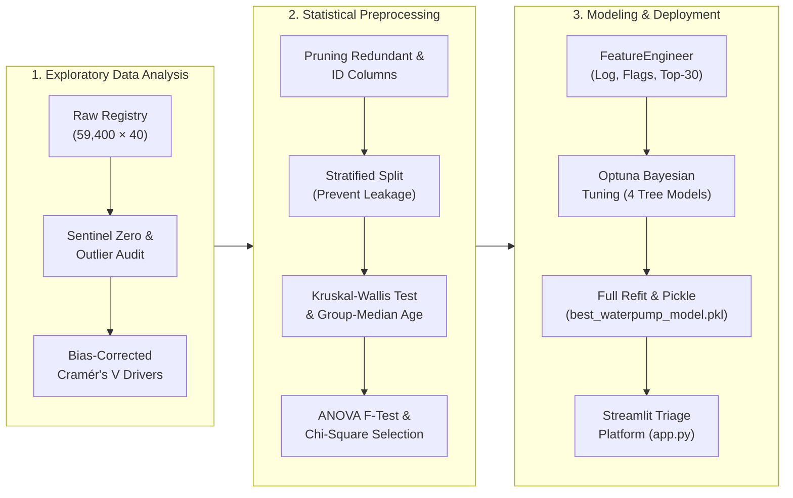

# 💧 Tanzania Waterpoint Functionality — End-to-End Data Mining & Prediction Platform


---

## 📖 Introduction

Tanzania currently suffers from a severe water crisis, with [28 percent of the population lacking access to safe water](https://water.org/our-impact/where-we-work/tanzania/#:~:text=Tanzania's%20water%20and%20sanitation%20crisis,safely%20managed%20household%20sanitation%20facilities.). One feasible way to combat this crisis is to ensure that the water pumps installed across the country remain functional.

Using the data procured by **Taarifa**, which aggregates data from the **Tanzania Ministry of Water** (*DrivenData: Pump it Up — Data Mining the Water Table*, comprising **59,400 waterpoints × 40 features**), there is a high-impact opportunity to leverage data mining and machine learning to detect water pumps that are non-functional or require preventive repair.

## 🎯 Objective

The aim of this project is to design an end-to-end data mining pipeline—spanning exploratory data analysis, statistical hypothesis testing, leak-free feature engineering, and Bayesian hyperparameter optimization—to **train and deploy a machine learning platform** that predicts whether a waterpoint is:
1. **`functional`** — Operational with no repairs needed
2. **`functional needs repair`** — Operational, but requires preventive maintenance
3. **`non functional`** — Completely out of service

---

## 🗂️ Repository Structure

```text
├── tanzania_waterpoint_eda.ipynb                      # Phase 1: Deep Exploratory Data Analysis & Anomaly Audit
├── tanzania_waterpoint_preprocessing_pipeline.ipynb   # Phase 2: Statistical Feature Selection & Leak-Free Imputation
├── tanzania_waterpoint_modeling_pipeline.ipynb        # Phase 3: Feature Engineering, Optuna Tuning & Serialization
├── feature_engineer.py                                # Modular Scikit-Learn Transformer & Preprocessor Pipeline
├── app.py                                             # All-in-One Streamlit Prediction & Triage Web Platform
├── requirements.txt                                   # Python Package Dependencies
└── README.md                                          # Project Documentation
```

---

## 🔄 End-to-End Data Mining Architecture



---

## 🔬 Key Analytical & Statistical Findings

### 1. Target Distribution & Operational Imbalance (`tanzania_waterpoint_eda.ipynb`)
* **`functional`**: **54.31%** (32,259 waterpoints) — Majority baseline
* **`non functional`**: **38.42%** (22,824 waterpoints)
* **`functional needs repair`**: **7.27%** (4,317 waterpoints) — **7.47 : 1 imbalance ratio** against the majority class. Catching pumps in this minority state is operationally vital because preventive repair is far cheaper than full replacement.

### 2. Disguised Missing Values (Sentinel Zeros) & Redundant Hierarchies
* While a naive `df.isnull().sum()` check reports zero missing values in 33 of 41 columns, our audit revealed widespread **sentinel zeros** masquerading as numeric measurements:
  * **`amount_tsh == 0`**: 70.1% of records
  * **`population ∈ {0, 1}`**: 47.82% unusable (36.0% encoded as `0`, plus 7,025 rows encoded as `1`)
  * **`construction_year == 0`**: 34.9% (20,709 records)
  * **`gps_height == 0`**: 34.4%
  * **Invalid GPS `(longitude == 0, latitude ≈ 0)`**: 1,812 rows off the coast of West Africa ("Null Island")
* **Exact 1:1 Duplicates**: `quantity` $\leftrightarrow$ `quantity_group` ($V = 1.0$) and `payment` $\leftrightarrow$ `payment_type` ($V = 1.0$) are pure duplicates, while `recorded_by` is a constant column with zero variance.

### 3. Dominant Predictive Signals
* **Water Quantity (`quantity` / `quantity_group`, Cramér's $V = 0.31$)**: The single strongest predictor. Waterpoints recorded as **`dry`** are **96.9% non-functional**, whereas **`enough`** water yields **65.2% functional**.
* **Community Governance & Payment (`payment`, Cramér's $V = 0.18$)**: Waterpoints where communities **`pay annually`** achieve **75.2% functionality**, compared to **44.9%** for **`never pay`** (a **30.3 percentage point spread**).
* **Geographic Disparity (`region`, Cramér's $V = 0.20$)**: Functionality spans **48.47 percentage points** from **Iringa (78.2% functional)** down to **Lindi (29.8% functional)**.
* **Infrastructure Age Decay**: Newly built waterpoints ($\le 5$ years old) are **71.51% functional**, degrading monotonically to **31.73% functional** for pumps $\ge 30$ years old.

### 4. Statistical Hypothesis Testing & Feature Selection (`tanzania_waterpoint_preprocessing_pipeline.ipynb`)
To prevent data leakage, all statistical tests and imputation parameters are computed **strictly on `X_train`** after stratified splitting:
* **Kruskal-Wallis Test on Pump Age ($H = 892.36, p = 1.68 \times 10^{-189}$)**: Confirmed that median waterpoint age varies significantly across `extraction_type_class` (`rope pump`: 3.0 yrs, `submersible`: 8.0 yrs, `handpump`: 11.0 yrs, `gravity`: 13.0 yrs, `other`: 18.0 yrs). Missing ages are imputed using leak-free **Group-Median Imputation**.
* **One-Way ANOVA $F$-Test**: Verified statistical significance ($p < 0.001$) for `age`, `gps_height`, `amount_tsh`, and `population`, while identifying **`num_private`** as statistically insignificant ($p \approx 0.323 \ge 0.05$) and pruning it.
* **Chi-Square Contingency Analysis**: Confirmed that all **14 retained categorical features** exhibit statistically significant dependence with `status_group` ($p < 0.001$ at $\alpha = 0.05$), yielding a refined **18-feature schema**.

---

## ⚙️ Modular Feature Engineering & Model Optimization (`tanzania_waterpoint_modeling_pipeline.ipynb`)

### Custom Scikit-Learn Transformer (`feature_engineer.py`)
The `FeatureEngineer` transformer encapsulates domain-specific transformations inside the cross-validation loop:
1. **Text Normalization & Rare Label Binning**: Normalizes casing/whitespace in `funder` and `installer`, learning the top 30 most frequent organizations on the training fold and grouping rare levels into `'other'`.
2. **Sentinel Binary Flags**: Creates `age_missing`, `gps_zero`, `pop_zero`, and `tsh_pos`.
3. **Logarithmic Compression**: Computes `log_pop` ($\log(1 + \text{population})$) and `log_tsh` ($\log(1 + \text{amount\_tsh})$) to tame extreme right-skewness (`amount_tsh` skew = 57.8).
4. **Institutional Alignment Flag**: Computes `same_funder_installer` (`funder == installer`).

### Model Benchmark Leaderboard (Holdout Test Set, $N = 11,880$)

All tree-based models were tuned via **Optuna** (`TPESampler`) using 3-Fold Stratified Cross-Validation:

| Rank | Model Architecture | CV Score (Micro F2) | Test Micro F1 | Test Micro F2 | Macro Avg Precision | Macro Avg Recall | Macro Avg F1 |
| :---: | :--- | :---: | :---: | :---: | :---: | :---: | :---: |
| **🥇 1** | **XGBoost (`hist`, Optuna Tuned)** | **0.7919** | **0.7950** | **0.7950** | **0.738** | **0.637** | **0.664** |
| 🥈 2 | **Random Forest (Optuna Tuned)** | 0.7924 | 0.7949 | 0.7949 | 0.743 | 0.629 | 0.656 |
| 🥉 3 | **CatBoost (Optuna Tuned)** | 0.7886 | 0.7945 | 0.7945 | 0.725 | 0.643 | 0.668 |
| 4 | **LightGBM (Optuna Tuned)** | 0.7903 | 0.7926 | 0.7926 | 0.728 | 0.636 | 0.662 |
| 5 | **Logistic Regression (Scaled)** | 0.7350 | 0.7370 | 0.7370 | — | — | — |
| 6 | **Dummy Classifier (Uniform)** | 0.3340 | 0.3351 | 0.3351 | — | — | — |

* **Operational 2×2 Triage (`functional` vs. `needs attention`)**: When grouping `functional needs repair` and `non functional` into an actionable **`needs attention`** class, the winning **XGBoost** pipeline achieves **91% recall on functional waterpoints** and **69% recall on waterpoints needing field intervention**.

---

## 🖥️ Prediction & Triage Platform (`app.py`)

We built an interactive **Streamlit Web Application** (`app.py`) to bridge the data mining pipeline with field operations:

1. **🔍 Single Waterpoint Predictor & Triage**:
   * Interactive inspection form for all 18 features with 1-click preset scenarios (*Healthy Standpipe*, *Aging Handpump Needing Repair*, *Dry/Broken Pump*).
   * Displays the predicted 3-class status, 2×2 operational dispatch recommendation, class probability breakdown, automated risk diagnostics, and the live `FeatureEngineer` output vector.
2. **📂 Batch CSV Prediction & Field Dispatch Schedule**:
   * Accepts both **18-column cleaned CSVs** and **raw 40-column DrivenData competition CSVs** (automatically computing `age` and applying Kruskal-Wallis group-median imputation).
   * Outputs summary KPIs and a prioritized field maintenance table sorted by **Needs Attention Score**, with 1-click CSV export.
3. **📊 Data Mining Insights & Model Leaderboard**:
   * Interactive reference dashboard summarizing the statistical tests, Cramér's V driver rankings, and multi-model benchmark results.

---

## 🚀 Quickstart & Installation

### 1. Clone the Repository & Install Dependencies
```bash
git clone <your-github-repo-url>
cd intelligent-lavoisier
pip install -r requirements.txt
```

### 2. Launch the Prediction Platform
```bash
streamlit run app.py
```
* **Automatic Model Resolution**: If `best_waterpump_model.pkl` (exported by `tanzania_waterpoint_modeling_pipeline.ipynb`) is present in the root folder, `app.py` loads it automatically. You can also upload a `.pkl` bundle via the sidebar, or use the built-in calibrated pipeline immediately out of the box.
